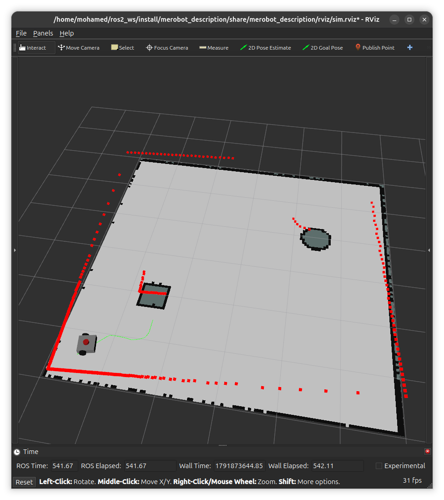
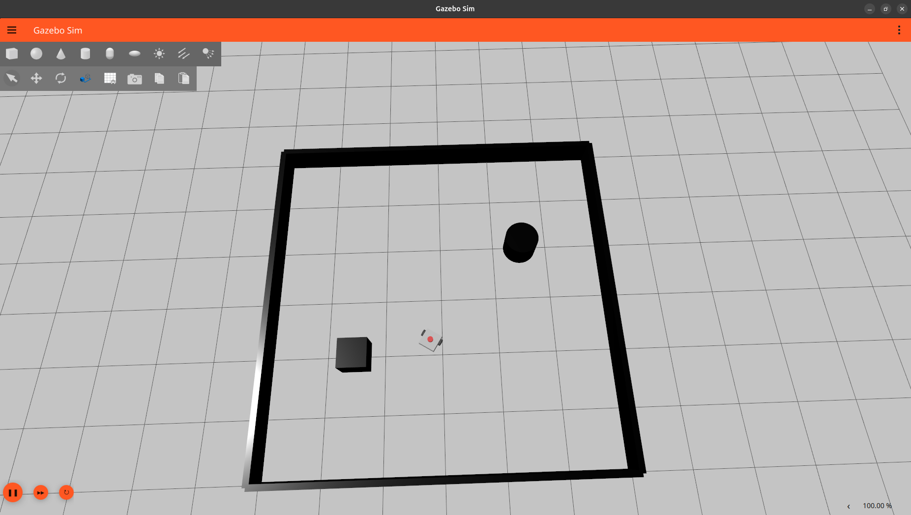
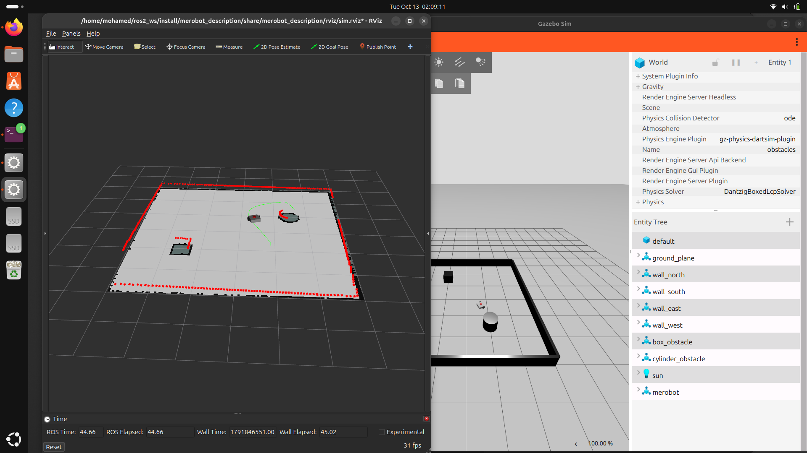

# merobot 🤖

An autonomous differential-drive mobile robot built from scratch with **ROS 2 Lyrical** and **Gazebo Jetty**.
The robot maps an unknown room with a LiDAR using SLAM, then navigates autonomously to any goal while avoiding obstacles using Nav2.

*Saved map (gray), live LiDAR scan (red) aligned with the walls, and the path planned by Nav2 (green).*

## Autonomous navigation

The goal is set with one click in RViz. The robot plans a path and drives there by itself, avoiding the box and the cylinder.

| Before: start position | After: goal reached autonomously |
|---|---|
|  |  |

## Features

- **Custom robot model** written in URDF/Xacro: chassis, two drive wheels, caster, and a 360° LiDAR, with mass and inertia tensors computed from rigid-body formulas
- **Physics simulation** in Gazebo with a differential-drive plugin and a ROS ↔ Gazebo bridge
- **Mapping** with `slam_toolbox` while driving the robot by keyboard
- **Autonomous navigation** with Nav2: AMCL localization, global path planning, and obstacle-aware path following
- **Single-command launch** for both mapping and navigation
- **Custom C++ nodes**: a status publisher and a heartbeat watchdog that detects when the robot stops reporting

## System architecture

~~~mermaid
flowchart LR
    Nav2[Nav2 / teleop] -->|/cmd_vel| Bridge[ros_gz_bridge]
    Bridge -->|gz Twist| Drive[DiffDrive plugin]
    Drive -->|odom, tf| Bridge
    Lidar[GPU LiDAR] -->|scan| Bridge
    Bridge -->|/scan, /odom, /tf| Loc[SLAM / AMCL]
    Loc -->|map → odom| Nav2
~~~

## Packages

| Package | Description |
|---|---|
| `merobot` | C++ nodes: `status_publisher` and `status_monitor` (heartbeat watchdog) |
| `merobot_description` | Robot URDF, Gazebo world, launch files, saved map and Nav2 configuration |

~~~
merobot_description/
├── urdf/       # Robot model (Xacro)
├── worlds/     # 6 m × 6 m room with obstacles (SDF)
├── launch/     # display, gazebo, mapping and navigation launch files
├── maps/       # Map generated with SLAM
├── config/     # Nav2 parameters
└── rviz/       # Saved RViz layouts
~~~

## Installation

Tested on **Ubuntu 26.04** with **ROS 2 Lyrical** and an NVIDIA RTX 3060.

~~~bash
sudo apt install ros-lyrical-ros-gz ros-lyrical-slam-toolbox \
  ros-lyrical-navigation2 ros-lyrical-nav2-bringup \
  ros-lyrical-teleop-twist-keyboard ros-lyrical-xacro \
  ros-lyrical-joint-state-publisher-gui

mkdir -p ~/ros2_ws/src && cd ~/ros2_ws/src
git clone https://github.com/mm45561/merobot.git .
cd ~/ros2_ws
colcon build
source install/setup.bash
~~~

## Usage

**Autonomous navigation** (uses the saved map):

~~~bash
ros2 launch merobot_description navigation.launch.py
~~~

Then in RViz, click **2D Goal Pose** and choose a target on the map.

**Build a new map:**

~~~bash
ros2 launch merobot_description mapping.launch.py
# in a second terminal, drive slowly:
ros2 run teleop_twist_keyboard teleop_twist_keyboard
# when the map is complete:
ros2 run nav2_map_server map_saver_cli -f ~/ros2_ws/src/merobot_description/maps/room
~~~

**View the robot model only:**

~~~bash
ros2 launch merobot_description display.launch.py
~~~

**Heartbeat watchdog demo:**

~~~bash
ros2 run merobot status_monitor
ros2 run merobot status_publisher   # in a second terminal
~~~

> On hybrid-graphics laptops, prefix the launch command with
> `__NV_PRIME_RENDER_OFFLOAD=1 __GLX_VENDOR_LIBRARY_NAME=nvidia` to render Gazebo on the NVIDIA GPU.

## Challenges solved

- **Nav2 velocity message type**: Nav2 in Lyrical publishes `TwistStamped` by default, while the Gazebo bridge expected `Twist`. Solved by overriding `enable_stamped_cmd_vel` for all Nav2 nodes in a custom parameter file.
- **Startup race condition**: Nav2 started before the simulation published odometry. Solved with a delayed `TimerAction` in the launch file.
- **Automatic localization**: Configured AMCL with a known initial pose, aligned with the map origin, so navigation starts without manual pose estimation.
- **SLAM map corruption**: Identified causes such as duplicate SLAM instances, fast rotation, and wheel slip on collisions.
- **GPU freezes in simulation**: Diagnosed the open-source `nouveau` driver hanging under Gazebo, then installed the signed NVIDIA driver with Secure Boot (MOK enrollment) and enabled PRIME render offload.

## Future work

- Add a camera and object detection
- Waypoint missions through multiple goals
- Deploy on real hardware (Raspberry Pi + ESP32 with micro-ROS)

## Author

**Mohamed Abdo**, Mechatronics Engineering student
